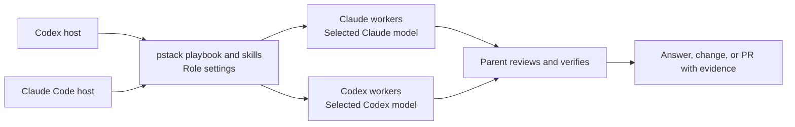

# pstack

pstack coordinates engineering work in Codex and Claude Code. Give it a goal and a way to check completion. `poteto-mode` selects a playbook, calls the skills and workers the task needs, and returns evidence for the result.

This is an unofficial adaptation of [Lauren Tan's pstack](https://github.com/cursor/plugins/tree/main/pstack). It also bundles `control-ui`, `control-cli`, and `deslop` from [cursor-team-kit](https://github.com/cursor/plugins/tree/main/cursor-team-kit).

Choose your host to get started:

- [Codex](#install-in-codex). Install `pstack-codex` and select workers with setup.
- [Claude Code](#install-in-claude-code). Install `pstack-cc` in the terminal or Claude desktop's local Code sessions.

The host is where you talk to the parent agent. Each workflow role has its own worker executor, model, and reasoning effort. Setup saves these choices separately for each host and leaves the parent chat model unchanged.



For example, start a development task in Codex with:

```text
$pstack-codex:poteto-mode the export writes duplicate rows when a retry lands mid-run. reproduce it, then fix and verify.
```

In Claude Code, use `/pstack-cc:poteto-mode` with the same request. Expect the agent to reproduce the issue, check the change against the real behavior, and report the evidence and remaining limits. The [Codex guide](plugin/docs/guide/README.md) and [Claude Code guide](plugin-claude/docs/guide/README.md) explain the playbooks and review steps.

pstack reuses your host and official CLI authentication, including subscription access supported by your account. API-key or Console credentials follow their own billing. Model access and usage limits still depend on your account and configuration. See [Codex authentication](https://learn.chatgpt.com/docs/auth) and [Claude Code authentication](https://code.claude.com/docs/en/authentication).

## Install in Claude Code

Use the Claude Code terminal client or Claude desktop's **Code** tab with a **Local** session. Ordinary Claude chat is not a pstack host. Setup needs Git, Node.js 24.12+, and the `claude` CLI. Native worker effort requires Claude Code 2.1.292+ with Agent effort support. Codex workers also need an authenticated Codex CLI. See the [setup guide](plugin-claude/docs/guide/01-setup.md) for CLI installation, login, and PATH troubleshooting.

In your terminal, add the marketplace from the repository's default branch and install the plugin:

```sh
claude plugin marketplace add https://github.com/ystory/pstack.git
claude plugin install pstack-cc@pstack-cc
```

In Claude desktop, open **Customize**, then **Plugins**, **Add plugin**, **Add marketplace**, and **Add from a repository**. Enter `ystory/pstack`, select **Sync**, and install the `pstack-cc` entry. See [Desktop setup](plugin-claude/docs/guide/01-setup.md#install) for UI variants.

Start a local Code session in your project and run:

```text
/pstack-cc:setup-pstack
```

Setup first asks for native Claude only, or Claude with Codex workers. It checks installation and login only for selected CLIs and guides any needed installation and human authentication. Then choose supported exact models, role assignments, and a reasoning budget across the 17 roles. Review the proposal before saving. Preferences live at `${CLAUDE_CONFIG_DIR:-~/.claude}/pstack-cc/models.json`, independently of Codex-host preferences.

Start a new session after setup so Claude discovers the registered agents. Try a read-only question about a real module in your project:

```text
/pstack-cc:how explain how src/cli.ts handles --help. Use the simple path with one explainer. Do not edit files.
```

Replace `src/cli.ts` with your module. A healthy run identifies the selected worker and returns an explanation based on the project's files. CLI discovery or login alone does not establish that a model can execute. The [execution binding](plugin-claude/skills/poteto-mode/references/claude-execution.md) describes the worker controls and host limits.

For updates and restores, follow [Update or remove](plugin-claude/docs/guide/01-setup.md#update-or-remove) and rerun setup. Before uninstalling, ask setup to unregister its owned agents while the plugin is still available. Native plugin removal does not clean up those registrations. Model preferences remain.

## Install in Codex

Setup first asks for native Codex only, or Codex with Claude Code workers. It checks installation and login only for selected CLIs, guides any needed installation and human authentication, and then helps you choose exact supported models, role assignments, and reasoning budget. No fixed model is required. The parent chat model stays unchanged.

A fresh saved configuration has no chosen roles. Before setup, missing scalar roles use one native-parent entry and panels or pools use two. Generic seats can run through the host's native general-purpose or default path when it supports the selected model and effort. The `poteto-agent` and `comment-sicko` custom roles require setup registration. Setup presents all 17 roles with unresolved choices. Saved exact selections take precedence. Required different-model or different-family checks apply only at the workflow step that needs them. If its eligible selected choices cannot satisfy a required verifier, that step retains its unmet outcome. Arena discloses and skips an unavailable judge. See [compatibility notes](docs/spec.md) for verified scope.

<details>
<summary>Codex requirements and optional workflow tools</summary>

- Codex with plugin and native subagent support, signed in to an account with access to your selected models.
- Git for Codex to fetch the GitHub marketplace.
- Node.js 24.12+ for setup and the bundled runtime helpers.
- Python 3.11+ for agent registration, using its standard-library TOML parser. Setup uses `python3` by default and can select another existing interpreter.
- An installed, authenticated Claude Code CLI 2.1.280+ only when you select Claude workers. Setup checks CLI capabilities; detection alone does not establish model access.
- Bun 1.2+ for the PR watcher helper. Its first use installs locked dependencies in a cache outside the plugin and may need network access. GitHub PR workflows also need an authenticated GitHub CLI (`gh`).
- Optional TLA+ statechart checks need Java and TLC. The first real check uses mise to install pinned tools unless existing tools are supplied. SVG rendering uses Pele separately. See the [statechart skill](plugin/skills/statechart/SKILL.md) for its commands and limits.

</details>

You need Codex with plugin and native subagent support, Git, Node.js 24.12+, and Python 3.11+. Select Claude workers during setup to prepare that optional CLI.

### Install

Add the GitHub marketplace, then install the plugin:

```sh
codex plugin marketplace add https://github.com/ystory/pstack.git
codex plugin add pstack-codex@pstack-codex
```

Codex reads the repository's marketplace catalog and installs the committed `plugin/` directory. You do not need to clone the repository, install project dependencies, or build it first. See [Development and maintenance](docs/stack.md) to build and verify a local artifact instead.

### Set up and use

Open a Codex chat in your project and run:

```text
$pstack-codex:setup-pstack
```

After worker selection, any needed CLI preparation, model selection, and review, setup registers the two bundled agents and a general-purpose role. It saves your reasoning budget and accepted role choices in `$CODEX_HOME/pstack-codex/models.json` (default `~/.codex/pstack-codex/models.json`). It preserves unrelated settings and stops on conflicts with user-edited managed files or declarations.

After setup, start a new chat so Codex discovers the registered roles. For a first walkthrough, try:

```text
$pstack-codex:how explain how this project starts up.
```

Use `$pstack-codex:poteto-mode` at the start of a development task to select a playbook, or `$pstack-codex:poteto-help` to find a suitable workflow. The [pstack guide](plugin/docs/guide/README.md) covers prompting, review, verification, and longer runs.

<details>
<summary>Update, restore, or remove the Codex plugin</summary>

### Update or restore

For a GitHub installation, refresh the Git marketplace and explicitly reinstall the plugin:

```sh
codex plugin marketplace upgrade pstack-codex
codex plugin add pstack-codex@pstack-codex
```

Run `$pstack-codex:setup-pstack` again to synchronize its managed registrations, then start a new chat. Saved model choices are retained.

To switch an existing local `pstack-codex` marketplace to GitHub, run the two [install commands](#install) above, then rerun setup and start a new chat. Adding the Git URL selects that source for the same marketplace identity; `marketplace upgrade` alone does not turn a local source into a Git source. For building, selecting, or restoring local artifacts, see [Development and maintenance](docs/stack.md#build-and-select-an-artifact).

The new `pstack-codex` identity has one current preference schema and no automatic migration from the old plugin. For a fresh replacement of an existing `pstack-for-codex` installation, invoke its old `$pstack-for-codex:setup-pstack` while still installed and ask it to unregister owned agents. Then remove the old plugin and marketplace before the new install commands:

```sh
codex plugin remove pstack-for-codex@pstack-for-codex
codex plugin marketplace remove pstack-for-codex
```

If the old plugin was already removed, run `node /absolute/old-checkout/plugin/skills/setup-pstack/scripts/register-agents.mjs --unregister` from its old checkout before installing the new plugin. Preserve unrelated settings. Old preferences are not imported or read by the new plugin.

### Remove

Before removing the plugin, run `$pstack-codex:setup-pstack` and ask it to unregister its managed agents. This removes unchanged owned registrations and leaves your model preferences in place. Then remove the plugin:

```sh
codex plugin remove pstack-codex@pstack-codex
```

There is no automatic uninstall hook to clean up registered agents after the plugin is removed.

</details>

## Docs and help

- [Codex guide](plugin/docs/guide/README.md) and [Claude Code guide](plugin-claude/docs/guide/README.md) cover setup, prompting, design, review, and verification.
- Use `$pstack-codex:poteto-help` or `/pstack-cc:poteto-help` to find a workflow.
- [Design and compatibility](docs/spec.md) separates source inspection, automated fixtures, and live runtime evidence. A successful build does not establish every workflow or account configuration.
- Report project and installation bugs in [GitHub issues](https://github.com/ystory/pstack/issues).

A single-model configuration cannot satisfy a required different-model or different-family verifier. Arena can disclose a skipped optional judge. Other required diversity gates remain requirements. See the [Codex model contract](plugin/skills/setup-pstack/references/models-contract.md) and [Claude Code model contract](plugin-claude/skills/setup-pstack/references/models-contract.md) for role and panel selection rules.

## Development and sources

For contributions:

1. Keep the pinned `upstream/` snapshots unchanged during adaptation work. Review source updates through the [upstream candidate workflow](docs/stack.md#review-an-upstream-update).
2. Implement Codex adaptations in `plugin/` or Claude Code adaptations in `plugin-claude/`. Record each target's change in its own series and [verify patch replay](docs/stack.md#record-an-adaptation).

- [Design and compatibility](docs/spec.md): adaptation behavior, source invariants, and verified runtime scope.
- [Development and maintenance](docs/stack.md): verification, patch management, upstream candidates, and artifact commands. The full verification workflow also requires `tar`.
- [Original pstack README](upstream/pstack/README.md): upstream project background.
- [pstack source lock](upstream.lock.json), [cursor-team-kit source lock](dependencies.lock.json), and [Codex worker runtime lock](codex-runtime.lock.json): pinned revisions, file mappings, and hashes.

The original Codex adaptation code and documentation are released under the [MIT license](LICENSE). The Codex bundle includes this license at `licenses/pstack-codex/LICENSE`; the Claude bundle uses `licenses/pstack-cc/LICENSE`. pstack is by Lauren Tan and retains its [MIT license](upstream/pstack/LICENSE). The bundled cursor-team-kit skills retain Cursor's [MIT license](upstream/cursor-team-kit/LICENSE). The Claude target also includes pinned official Codex worker code and its notices under `vendor/codex-plugin-cc/`. Original copyright and license notices are preserved in each distribution.
